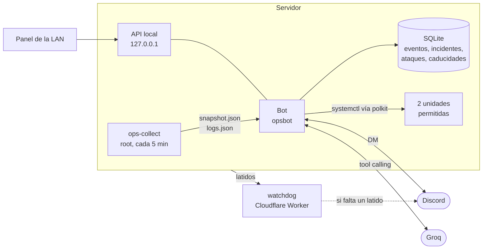

# asistente-ops

Asistente de operaciones para mi servidor casero: un bot de Discord al que le pregunto cómo va todo desde el móvil, sin abrir SSH. Lleva tres piezas:

| Pieza | Dónde corre | Qué hace |
| --- | --- | --- |
| `collector/ops-collect` | Servidor, root, timer cada 5 min | Foto del estado en un JSON y lotes de avisos y ataques sacados del journal |
| `bot/` | Servidor, usuario `opsbot` sin privilegios | Responde por DM con un LLM (Groq) y herramientas, manda un resumen diario, propone acciones con botón y sirve una API local para un panel |
| `watchdog/` | Cloudflare Workers | Vigilante externo: si el servidor o los backups dejan de dar señales, avisa por DM |

Forma parte de mi [homelab](https://github.com/IsDerky/homelab). Los ataques que ve salen, entre otros sitios, de mi [honeypot](https://github.com/IsDerky/cowrie-honeypot).

## Cómo funciona



El recolector corre como root porque necesita leer SMART, el journal y fail2ban. El bot no: solo lee el JSON que deja el recolector. La separación es a propósito, porque el proceso que habla con internet y con un LLM es el que menos permisos tiene.

## Qué recoge el recolector

- Sistema, SMART, servicios, backups y simulacro de restauración, certificados de Let's Encrypt, `docker stats`, baneos de fail2ban y la versión desplegada de mi app.
- **Pterodactyl**: estado y consumo de los servidores de cada nodo, preguntando a la API de Wings. Los tokens se pasan a curl por stdin para que no salgan en `ps`, y la configuración de los servidores de los clientes se descarta sin guardarla.
- **Journal**: los avisos se agrupan por huella (el mensaje sin números, IDs, IPs, rutas ni fechas), así se distingue lo nuevo de lo de siempre.
- **Ataques**: fuerza bruta al SFTP de Wings, sondas web en los logs de nginx y el honeypot Cowrie, incluidos los ficheros que suben. Del SFTP solo se guarda el usuario si no tiene el formato de los usuarios de Pterodactyl, o sea, si seguro que no es un cliente.

## Qué hace el bot

- **Responde preguntas por DM**: "¿qué tal fue el backup?", "¿quién me ataca?", "¿cuántos puertos me quedan libres?". El modelo usa herramientas de solo lectura sobre los datos reales; el prompt le prohíbe inventar cifras.
- **Acciones con botón**: el modelo solo puede *proponer* (reiniciar la app, lanzar un backup, encolar descargas). Se ejecutan cuando pulso Confirmar; el botón es de un solo uso y caduca a los 10 minutos. Los permisos los da polkit (`deploy/50-asistente.rules`): `opsbot` solo puede reiniciar una unidad y arrancar otra, nada más.
- **Memoria de incidentes** con búsqueda FTS5: antes de diagnosticar, el modelo mira si ya pasó y qué lo arregló. Viene precargada con incidentes reales del servidor.
- **Caducidades**: certificados (avisa a 20, 7 y 2 días), dominios por RDAP y recordatorios que le dicto ("recuérdame el 5/12 renovar…").
- **Resumen diario** por la mañana con lo que importa: backups, caducidades, ataques, el servidor de clientes que más RAM usa…
- **Solo avisa de lo grave.** Las anomalías de logs las aprende en silencio y me las cuenta si le pregunto; probé a avisar de todo y era ruido.
- **API local para el [panel de la LAN](https://github.com/IsDerky/oficina-pixel)** (`/api/state`, `/api/events` por SSE, `/api/honeypot`…). Escucha solo en `127.0.0.1` y nginx la publica solo para la LAN.

Solo atiende DMs de un usuario. Su ID está fijado en el código (`bot/src/config.ts`), no en el `.env`: si el `.env` se escribe mal, el bot no arranca, en vez de abrirle la puerta a otro.

## Vigilante externo

Un Worker de Cloudflare con un cron cada 5 minutos y KV. El servidor le manda latidos con `curl` y un token; si alguna señal no llega a tiempo, me escribe por Discord, me lo recuerda cada 24 h y avisa cuando vuelve. Está fuera del servidor a propósito: si el servidor se apaga entero, no puede avisar desde dentro. Montaje en [`watchdog/README.md`](watchdog/README.md).

## Instalar

En el servidor, como root, con [Bun](https://bun.sh) en `/usr/local/bin/bun` o el binario copiado como `./bun`:

```bash
git clone https://github.com/IsDerky/asistente-ops.git && cd asistente-ops
# pon tu ID de Discord en bot/src/config.ts (OWNER_DISCORD_ID)
bash deploy/install.sh    # la primera vez crea /etc/asistente.env y para
nano /etc/asistente.env   # tokens de Discord y Groq, y lo que quieras activar
bash deploy/install.sh
```

`install.sh` es idempotente: crea el usuario `opsbot`, instala el recolector con su timer, copia el bot a `/opt/asistente`, pone la regla de polkit y arranca todo. La unidad (`deploy/asistente.service`) corre con `ProtectSystem=strict`, `ProtectHome`, `NoNewPrivileges` y compañía.

Las acciones con botón están pensadas para mis unidades (`bentonime.service` y `server-backup@sistema.service`). Para otras, toca cambiar `deploy/50-asistente.rules` y `bot/src/actions.ts`.

## Probar

```bash
cd bot && bun install && bun test
bun src/cli.ts informe      # en el servidor: los datos que ve el modelo, sin IA
```

## Licencia

MIT
